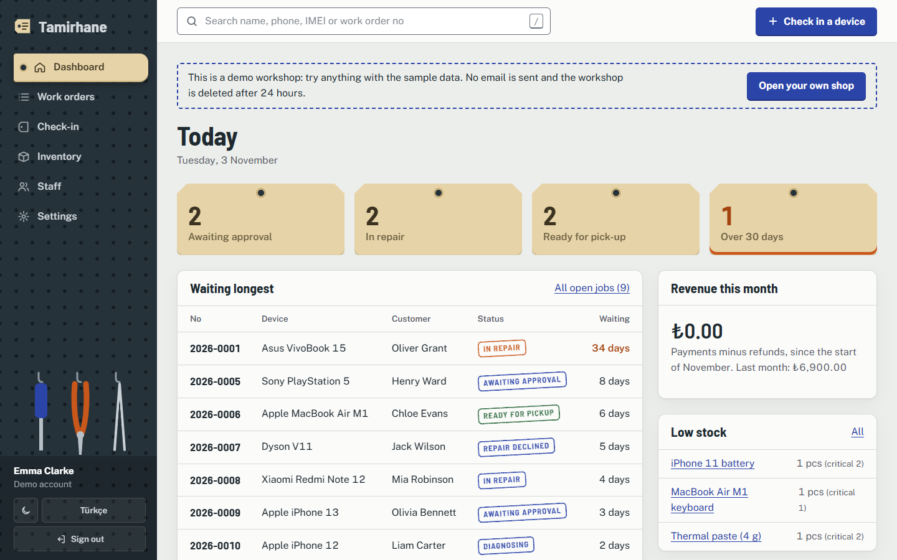
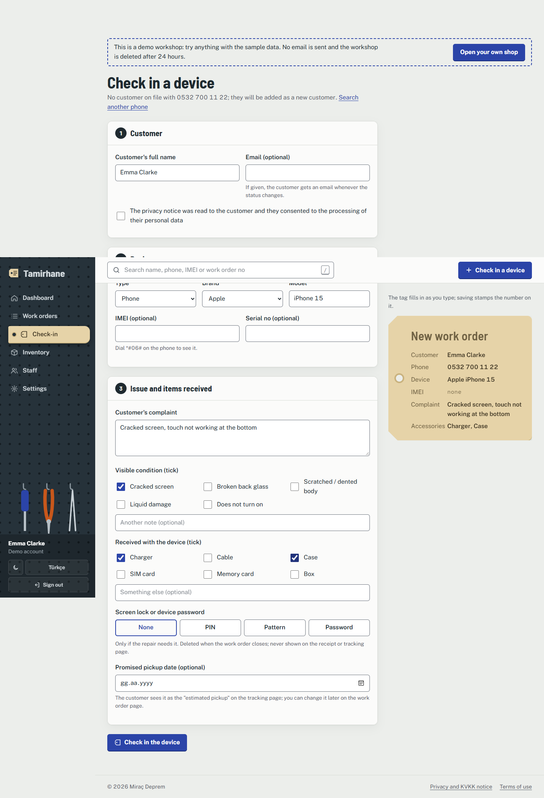
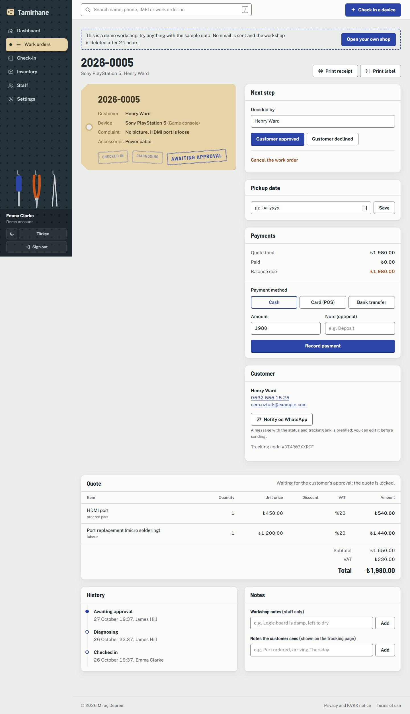
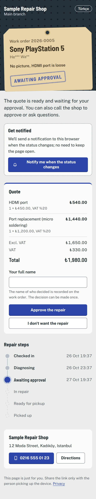
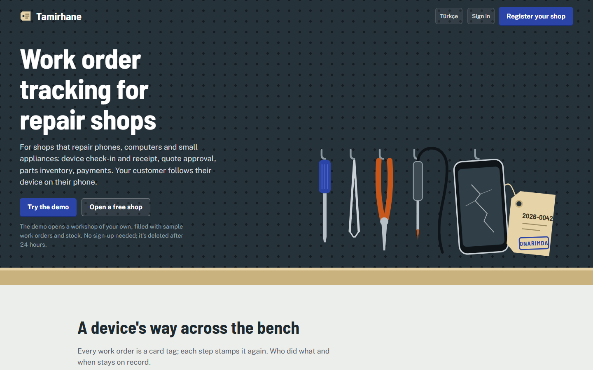
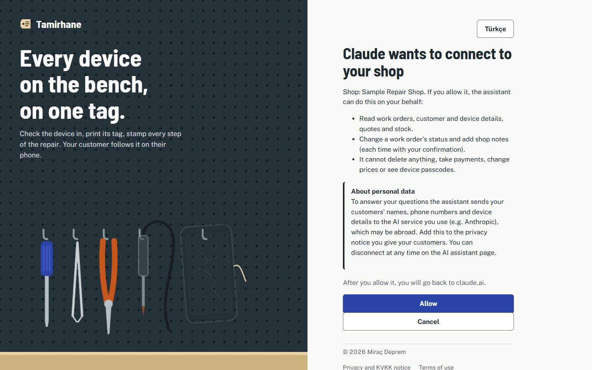
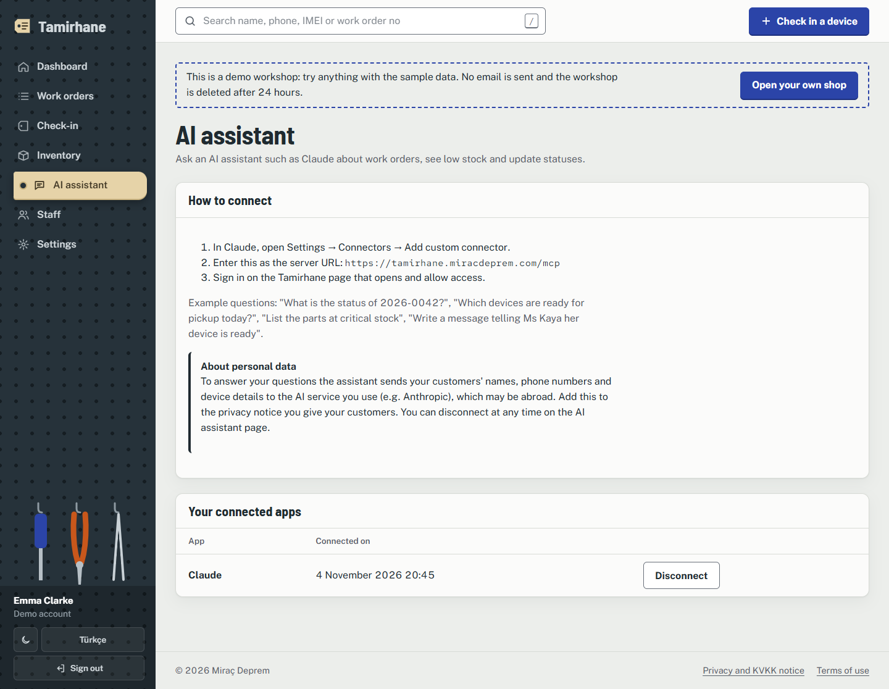

English | [Türkçe](README.tr.md)

# Tamirhane

Free repair shop software for phone, computer and appliance repair shops: device check-in with a printable receipt, work orders, quotes the customer approves from a tracking link, parts stock, payments and warranty. Customers follow their repair on their phone without an account. Built with ASP.NET Core MVC on Clean Architecture.

**Live:** [tamirhane.miracdeprem.com](https://tamirhane.miracdeprem.com) · try the demo shop without signing up ([English](https://tamirhane.miracdeprem.com/en/))

## Features

**Check-in at the counter**
- Find the customer by phone; a returning customer and their devices come up, nobody is typed twice
- Form changes with the device type (12 types, phone to large appliance): brand list, model suggestions from the shop's own history, IMEI only where it exists, screen lock type (PIN, pattern, password)
- Tick boxes for visible condition and accessories received
- Printable A5 receipt with a QR code to the tracking page, and a device tag for label printers

**Work orders**
- Status flow: Checked in → Diagnosing → Awaiting approval → In repair → Ready → Delivered; invalid steps are refused in the domain
- Quotes with parts from stock and labour, VAT and discount per line; approval recorded with name and time
- Parts stock per branch with low-stock levels; used parts leave stock, cancelled ones come back
- Payments (cash, card, transfer), partial payments and balance due; warranty starts on delivery and a returning device links to its old work order
- Device passcode stored encrypted and shown to staff only on click; deleted when the work order closes

**Customer side**
- Login-free tracking page: status timeline, expected date, quote approval or refusal, shop address and phone
- Email on every status change, browser notifications (on iPhone after adding the page to the Home Screen), one-click WhatsApp message

**Shop**
- Dashboard: awaiting approval, in repair, ready, waiting over 30 days, monthly revenue, low stock
- Multi-tenant: every shop's data is isolated; branches, owner and technician roles, staff invited by email
- Turkish and English (English under `/en`), light and dark theme, works on a phone at the counter
- Public demo shop with sample data, deleted after 24 hours; the owner can delete the shop and all its data

**AI assistant (MCP)**
- Connect Claude (or another MCP client) to your shop and ask in plain language: "What is the status of 2026-0042?", "Which devices are ready for pickup?", "What is low on stock?"
- The assistant can move a work order to the next status and add a shop note; it cannot delete anything, take payments, change prices or see device passcodes
- Sign-in with OAuth 2.1: the shop owner or technician approves on a consent screen, sees the connected apps and can disconnect them at any time

## Screenshots

| Dashboard | Check-in |
|---|---|
|  |  |

| Work order | Customer tracking page |
|---|---|
|  |  |



| Connecting an AI assistant | Connected apps |
|---|---|
|  |  |

## Architecture

Clean Architecture: dependencies only point inward.

```
Tamirhane.Web  ──►  Tamirhane.Application  ──►  Tamirhane.Domain
      │                      ▲
      └──► Tamirhane.Infrastructure (only to register services in Program.cs)
```

| Project | Responsibility |
|---|---|
| `Tamirhane.Domain` | Entities and business rules: work order status flow, quote totals, stock, warranty, IMEI check. No framework references. |
| `Tamirhane.Application` | Use cases (one class each) and interfaces for storage, email, push, the clock and passcode encryption. |
| `Tamirhane.Infrastructure` | EF Core + PostgreSQL, ASP.NET Core Identity, Resend email, Web Push, QR codes, Data Protection. |
| `Tamirhane.Web` | MVC controllers and views, localisation, security headers, rate limits. The MCP server and OAuth endpoints are a second presentation layer here that calls the same use cases. |

The dependency rule is checked by `Tamirhane.Architecture.Tests`. 744 tests run against a real PostgreSQL in Docker (Testcontainers).

Security in short: strict CSP with Trusted Types, CSRF tokens on every POST (a test walks all POST endpoints), per-IP rate limits, `__Host-` cookies, tenant filter on every query, passwords hashed by Identity, Data Protection keys on the server's disk, encrypted device passcodes, TLS-verified database connection.

## Tech Stack

- C#, ASP.NET Core MVC, Entity Framework Core, PostgreSQL (Neon)
- ASP.NET Core Identity, Data Protection
- htmx, Motion (animations), plain CSS
- Resend (email), Web Push (VAPID)
- Model Context Protocol (C# SDK), OpenIddict (OAuth 2.1)
- xUnit, Testcontainers, NetArchTest
- Oracle Cloud (Ubuntu, systemd), Caddy

## Installation

Requirements: the current .NET SDK and Docker (local database and integration tests).

```sh
git clone https://github.com/MrcDprm/tamirhane-repair-tracker.git
cd tamirhane-repair-tracker
docker run -d --name tamirhane-db -e POSTGRES_USER=tamirhane -e POSTGRES_PASSWORD=tamirhane -e POSTGRES_DB=tamirhane -p 5433:5432 postgres:17-alpine
cp .env.example .env          # values are explained in the file; empty RESEND_API_KEY prints emails to the console
dotnet tool install --global dotnet-ef
dotnet ef database update --project src/Tamirhane.Infrastructure --startup-project src/Tamirhane.Infrastructure
dotnet run --project src/Tamirhane.Web --launch-profile https
```

Open https://localhost:7071 and press "Try the demo", or register a shop (the verification link appears in the console).

Tests: `dotnet test` (integration tests are skipped with a note if Docker is not running).

Deployment to a Linux server behind Caddy: [deploy/README.md](deploy/README.md).

## Use with Claude

1. In Claude, open Settings → Connectors → Add custom connector.
2. Server URL: `https://tamirhane.miracdeprem.com/mcp` (for a local run: `https://localhost:7071/mcp`).
3. Sign in on the Tamirhane page that opens and press Allow. Connected apps are listed under **AI assistant** in the menu.

Tools: `find_work_order`, `list_work_orders`, `low_stock`, `change_status`. Before a status change the client asks you to confirm.

## What I Learned

- **Clean Architecture for real:** I kept the domain free of EF Core and ASP.NET and let a test fail the build when a project references the wrong layer. Business rules like "you can't deliver a device with a balance due" live in one place and are tested without a database.
- **Multi-tenancy:** every shop's data is filtered by a global EF Core query filter fed from the signed-in user. I wrote tests that try to read another shop's records, and reviewed every place the filter is deliberately switched off.
- **Security headers and CSP:** I learned why inline scripts and styles had to go, how Trusted Types blocks `innerHTML` while htmx still works through one policy, and how a test that walks every POST endpoint keeps CSRF protection from silently disappearing.
- **Rate limiting behind proxies:** on Render the last `X-Forwarded-For` hop was Render's own proxy, so all visitors shared one limit; email link scanners locked real users out. I moved to my own server behind Caddy and trust the header only from localhost.
- **Hosting trade-offs:** a free plan that sleeps makes the first click take a minute. A self-contained ReadyToRun build as a hardened systemd service on a free ARM VM was faster and cheaper, but I also learned that the runtime then has to be updated by me.
- **Encrypting data at rest:** device passcodes are encrypted with ASP.NET Data Protection and the keys live on the server's disk, not in the database, so a database leak alone reveals nothing.
- **Localisation and SEO:** a language prefix moved into `PathBase` gives every generated link `/en` for free. A `__Host-` cookie then needs `Path=/`, otherwise browsers drop it; the test client didn't enforce this, so I added a test that does.
- **Letting an AI assistant in safely:** I built an OAuth 2.1 authorization server with OpenIddict that follows what MCP clients expect: discovery documents, dynamic client registration limited to known redirect addresses, PKCE and resource indicators. The token only names the user; shop, role and branch are read from the database on every request, so removing a staff member or disconnecting the app takes effect on the next call. Text written by customers is returned as data in its own field so it can't pass as an instruction to the assistant.
- **Product details:** the check-in form adapts to the device type, a phone layout was checked at 320 to 768 pixels in both languages, and iPhone notifications needed a web app manifest per tracking page.

## License

[AGPL-3.0](LICENSE). If your company can't meet the AGPL terms (for example, you want to change the code without publishing the changes), a commercial license is possible: [get in touch](https://www.miracdeprem.com/#contact).
