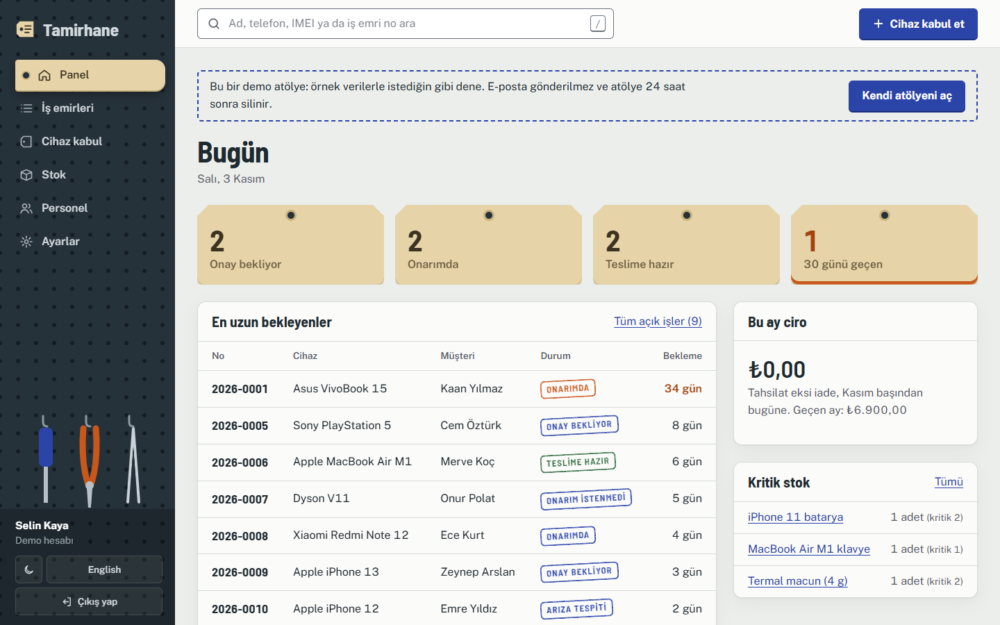
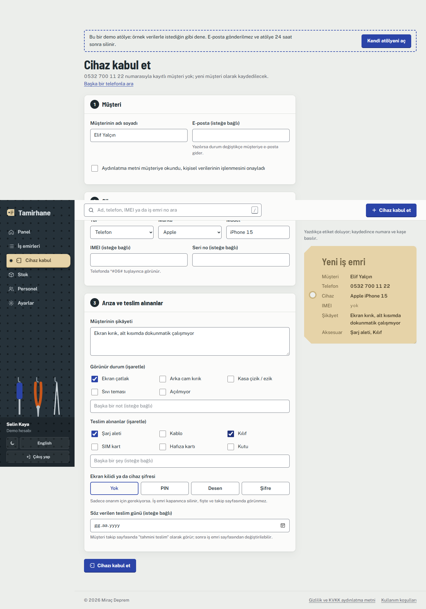
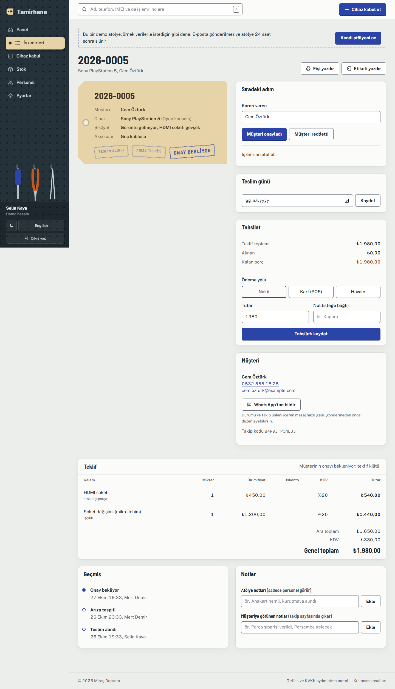
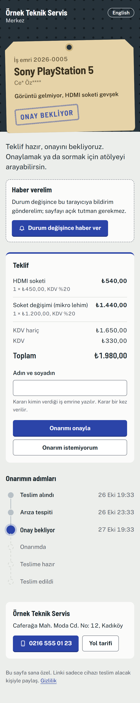
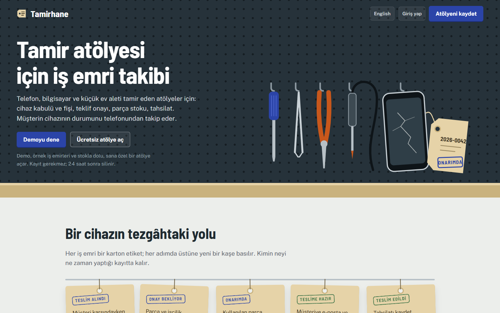

[English](README.md) | Türkçe

# Tamirhane

Telefon, bilgisayar ve ev aleti tamir eden atölyeler için ücretsiz teknik servis ve tamir takip programı: yazdırılabilir fişle cihaz kabulü, iş emri, müşterinin takip linkinden onayladığı teklif, parça stoku, tahsilat ve garanti. Müşteri cihazının durumunu hesap açmadan telefonundan takip eder. ASP.NET Core MVC ve Clean Architecture ile yazıldı.

**Canlı:** [tamirhane.miracdeprem.com](https://tamirhane.miracdeprem.com) · kayıt olmadan demo atölyeyi dene ([English](https://tamirhane.miracdeprem.com/en/))

## Özellikler

**Tezgâhta cihaz kabulü**
- Müşteri telefonla bulunur; tekrar gelen müşteri ve cihazları gelir, kimse iki kez yazılmaz
- Form cihaz türüne göre değişir (telefondan beyaz eşyaya 12 tür): marka listesi, atölyenin kendi geçmişinden model önerileri, sadece olan cihazda IMEI, ekran kilidi türü (PIN, desen, şifre)
- Görünür durum ve teslim alınan aksesuarlar için işaret kutuları
- Takip sayfasına QR kodlu, yazdırılabilir A5 kabul fişi ve etiket yazıcısına uygun cihaz etiketi

**İş emri**
- Durum akışı: Teslim alındı → Arıza tespiti → Onay bekliyor → Onarımda → Teslime hazır → Teslim edildi; geçersiz adım domain'de reddedilir
- Stoktan parça ve işçilik kalemli teklif, kalem başına KDV ve iskonto; onay ad ve zamanla kaydedilir
- Şube başına parça stoku ve kritik seviye; kullanılan parça stoktan düşer, iptalde geri döner
- Tahsilat (nakit, kart, havale), kısmi ödeme ve kalan borç; garanti teslimde başlar, geri dönen cihaz eski iş emrine bağlanır
- Cihaz şifresi şifreli saklanır, sadece personele tıklayınca görünür; iş emri kapanınca silinir

**Müşteri tarafı**
- Giriş gerektirmeyen takip sayfası: durum zaman çizelgesi, tahmini teslim, teklif onayı ya da reddi, atölyenin adresi ve telefonu
- Her durum değişiminde e-posta, tarayıcı bildirimi (iPhone'da sayfa ana ekrana eklenince), tek tıkla WhatsApp mesajı

**Atölye**
- Panel: onay bekleyenler, onarımdakiler, teslime hazırlar, 30 günü geçenler, aylık ciro, kritik stok
- Çok kiracılı: her atölyenin verisi ayrı; şubeler, sahip ve teknisyen rolleri, e-postayla personel daveti
- Türkçe ve İngilizce (İngilizce `/en` altında), açık ve koyu tema, tezgâhta telefondan kullanılabilir
- Örnek verili, 24 saat sonra silinen herkese açık demo atölye; sahip atölyeyi bütün verisiyle silebilir

## Ekran Görüntüleri

| Panel | Cihaz kabul |
|---|---|
|  |  |

| İş emri | Müşterinin takip sayfası |
|---|---|
|  |  |



## Mimari

Clean Architecture: bağımlılıklar sadece içe doğru.

```
Tamirhane.Web  ──►  Tamirhane.Application  ──►  Tamirhane.Domain
      │                      ▲
      └──► Tamirhane.Infrastructure (sadece Program.cs'te servis kaydı için)
```

| Proje | Görevi |
|---|---|
| `Tamirhane.Domain` | Varlıklar ve iş kuralları: iş emri durum akışı, teklif toplamları, stok, garanti, IMEI kontrolü. Hiçbir çatıya bağlı değil. |
| `Tamirhane.Application` | Kullanım senaryoları (her biri tek sınıf); depolama, e-posta, bildirim, saat ve şifre şifreleme arayüzleri. |
| `Tamirhane.Infrastructure` | EF Core + PostgreSQL, ASP.NET Core Identity, Resend e-posta, Web Push, QR kod, Data Protection. |
| `Tamirhane.Web` | MVC controller ve görünümler, dil desteği, güvenlik başlıkları, istek sınırları. |

Bağımlılık kuralını `Tamirhane.Architecture.Tests` denetler. 734 test Docker'daki gerçek bir PostgreSQL'e karşı çalışır (Testcontainers).

Kısaca güvenlik: Trusted Types'lı sıkı CSP, her POST'ta CSRF token'ı (bir test bütün POST uçlarını gezer), IP başına istek sınırı, `__Host-` çerezler, her sorguda kiracı filtresi, Identity ile hash'lenmiş şifreler, sunucu diskinde Data Protection anahtarları, şifreli cihaz şifreleri, sertifikası doğrulanan veritabanı bağlantısı.

## Kullanılan Teknolojiler

- C#, ASP.NET Core MVC, Entity Framework Core, PostgreSQL (Neon)
- ASP.NET Core Identity, Data Protection
- htmx, Motion (hareket), düz CSS
- Resend (e-posta), Web Push (VAPID)
- xUnit, Testcontainers, NetArchTest
- Oracle Cloud (Ubuntu, systemd), Caddy

## Kurulum ve Çalıştırma

Gerekenler: güncel .NET SDK ve Docker (yerel veritabanı ve entegrasyon testleri için).

```sh
git clone https://github.com/MrcDprm/tamirhane-repair-tracker.git
cd tamirhane-repair-tracker
docker run -d --name tamirhane-db -e POSTGRES_USER=tamirhane -e POSTGRES_PASSWORD=tamirhane -e POSTGRES_DB=tamirhane -p 5433:5432 postgres:17-alpine
cp .env.example .env          # değerler dosyada açıklanıyor; RESEND_API_KEY boşsa e-postalar konsola yazılır
dotnet tool install --global dotnet-ef
dotnet ef database update --project src/Tamirhane.Infrastructure --startup-project src/Tamirhane.Infrastructure
dotnet run --project src/Tamirhane.Web --launch-profile https
```

https://localhost:7071 adresini açıp "Demoyu dene"ye bas ya da bir atölye kaydet (doğrulama linki konsolda görünür).

Testler: `dotnet test` (Docker çalışmıyorsa entegrasyon testleri nedeni yazılarak atlanır).

Caddy arkasında bir Linux sunucuya yayın: [deploy/README.md](deploy/README.md).

## Öğrendiklerim

- **Gerçekten Clean Architecture:** Domain'i EF Core'dan ve ASP.NET'ten bağımsız tuttum; bir proje yanlış katmana bağlanırsa bir test düşüyor. "Borcu olan cihaz teslim edilemez" gibi kurallar tek bir yerde duruyor ve veritabanı olmadan test ediliyor.
- **Çok kiracılık:** Her atölyenin verisi, oturum açan kullanıcıdan beslenen genel bir EF Core sorgu filtresiyle süzülüyor. Başka atölyenin kaydını okumaya çalışan testler yazdım; filtrenin bilerek kapatıldığı her yeri tek tek gözden geçirdim.
- **Güvenlik başlıkları ve CSP:** Satır içi betik ve stilin neden kalkması gerektiğini, Trusted Types'ın `innerHTML`'i nasıl engellediğini ve htmx'in tek bir politikayla yine de nasıl çalıştığını öğrendim. Bütün POST uçlarını gezen bir test, CSRF korumasının sessizce kaybolmasını engelliyor.
- **Vekil sunucu arkasında istek sınırı:** Render'da `X-Forwarded-For`'un son adresi Render'ın kendi vekiliydi; bütün ziyaretçiler tek bir sınırı paylaşıyordu ve e-posta link tarayıcıları gerçek kullanıcıyı kilitledi. Caddy'li kendi sunucuma taşıdım ve başlığa sadece aynı makineden gelirse inanıyorum.
- **Barındırma tercihleri:** Uyuyan ücretsiz bir plan ilk tıklamayı bir dakika bekletiyor. Ücretsiz ARM sunucuda, sıkılaştırılmış bir systemd servisi olarak önceden derlenmiş (ReadyToRun) yayın hem daha hızlı hem bedava oldu. Karşılığında .NET çalışma ortamını güncel tutmanın artık benim işim olduğunu öğrendim.
- **Veriyi şifreli saklamak:** Cihaz şifreleri ASP.NET Data Protection ile şifreleniyor. Anahtarlar veritabanında değil sunucunun diskinde duruyor; veritabanı tek başına sızsa bir şey açığa çıkmıyor.
- **Dil desteği ve SEO:** Dil önekini `PathBase`'e almak, üretilen her linke `/en`'i kendiliğinden ekliyor. Ama `__Host-` önekli çerez o zaman `Path=/` istiyor, yoksa tarayıcı onu reddediyor. Test istemcisi bu kuralı uygulamadığı için kuralı denetleyen bir test ekledim.
- **Ürün ayrıntıları:** Kabul formu cihaz türüne göre değişiyor. Telefon görünümünü iki dilde 320-768 piksel arasında taradım. iPhone bildirimleri için her takip sayfasına ayrı bir web uygulaması tanımı gerekti.

## Lisans

[AGPL-3.0](LICENSE). Şirketin AGPL şartlarını karşılayamıyorsa (örneğin kodu değiştirip değişiklikleri yayınlamak istemiyorsan) ticari lisans mümkün: [iletişime geç](https://www.miracdeprem.com/#contact).
